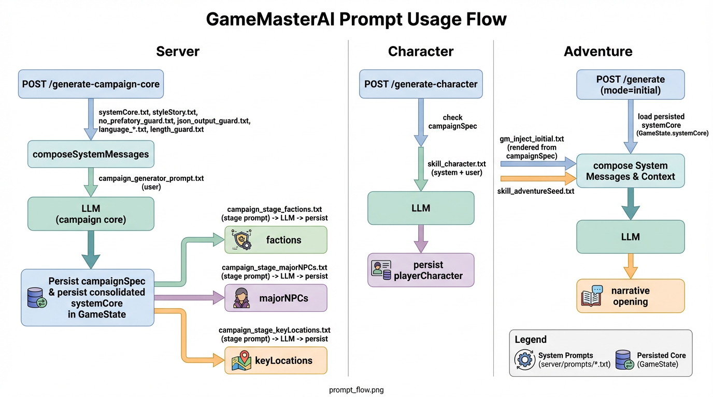

# Dungeon Master — Prompt Flow Overview

This repository powers Dungeon Master (a DM assistant). The diagram below shows how server-side prompts are loaded, rendered, injected, and used across campaign generation, background stages, character creation, and adventure (initial scene) generation.

Diagram (rendered image)




Notes
- The canonical prompt templates are embedded in the Go binary from `go/internal/prompts/promptfiles/` (Mustache variables such as `{{campaignConcept}}`, `{{#factions}}...{{/factions}}`, or `{{languageInstruction}}`).
- Campaign generation is intentionally small and reliable; background stages expand the campaign and are persisted.
- Initial adventure generation injects DM-only rendered context from the persisted `campaignSpec` so adventures relate to the campaign background while starting naturally.

# Dungeon Master

Dungeon Master is a web-based application designed to deliver a tabletop role-playing game (TTRPG) experience, guided by an AI Dungeon Master. Players sign in with **Google**, games are **scoped to accounts** (with optional **invite links** for additional players in the same campaign). Utilizing cutting-edge AI language models such as GPT-3.5-turbo and GPT-4, this platform offers a seamless integration of an AI Dungeon Master with an AI notetaker to craft an immersive narrative for games like Dungeons & Dragons.

The project originated from Cole Porter (Deck of DM Things on YouTube) and was supported by a dedicated Patreon community. When the project grew beyond the scope manageable by Cole, the decision was made to open-source Dungeon Master and discontinue the Patreon.

## Table of Contents

- [Prerequisites](#prerequisites)
- [Setting up External Dependencies](#setting-up-external-dependencies)
- [Installation](#installation)
- [Testing](#testing)
- [Debugging LLM calls](#debugging-llm-calls)
- [Usage](#usage)
- [Contributing](#contributing)
- [License](#license)
- [Credits](#credits)
- [Contact](#contact)

## Prerequisites

- **Go** (1.22+) to build and run `gmai-server` (`npm start` from the repository root). Optional **[Air](https://github.com/air-verse/air)** for auto-rebuild: `go install github.com/air-verse/air@v1.52.3` (pin avoids newer Air requiring Go 1.25+), then `npm run dev` from the repo root (the script prepends `$(go env GOPATH)/bin` to `PATH` so `air` is found; watches `go/` and prompt `*.txt` under `go/internal/prompts/promptfiles/`). Use `@latest` if your toolchain is current.
- **Node.js** and **npm** for the Vue client (`client/dungeonmaster`) and tooling listed in the root `package.json`.

## Setting up External Dependencies

### .env File

For proper functioning of the application, you must set up the following environment variables:

#### MongoDB Atlas

- **Purpose**: Storing game save data and user accounts.
- **Setup**:
  1. Sign up or log in to [MongoDB Atlas](https://www.mongodb.com/cloud/atlas).
  2. Create a new cluster and follow the setup guide.
  3. Retrieve your connection string by navigating to the 'Connect' section of your cluster.
  4. In your `.env` file, add `DM_MONGODB_URI=your_connection_string`.

#### OpenAI API

- **Purpose**: Interacting with AI models for generating and managing game content.
- **Setup**:
  1. Sign up for an account at [OpenAI](https://openai.com/).
  2. Generate an API key in the API section.
  3. In your `.env` file, add `DM_OPENAI_API_KEY=your_api_key`.

#### DeepSeek (alternative to OpenAI)

- **Purpose**: Same role as OpenAI — DeepSeek serves an OpenAI-compatible chat-completions API, so only the endpoint, key and model change.
- **Setup**:
  1. Create an API key at [platform.deepseek.com](https://platform.deepseek.com/).
  2. In your `.env` file:
     ```bash
     DM_AI_PROVIDER=deepseek
     DM_DEEPSEEK_API_KEY=sk-...
     # optional, these are the defaults:
     DM_DEEPSEEK_MODEL=deepseek-chat
     DM_DEEPSEEK_URL=https://api.deepseek.com
     ```
  3. Restart the server: `.env` is read once at startup, and the log line `AI provider: deepseek at …` confirms which backend this process uses.
- **Notes**: use a plain chat model (`deepseek-chat`). Reasoning models (`deepseek-reasoner`, `deepseek-flash`) spend the output budget on hidden reasoning tokens — a 550-token stage can come back with ~130 tokens of actual reply, truncated mid-document, which then fails to parse. `DM_MODEL_CONTEXT_TOKENS` defaults to 16384; raise it (e.g. `65536`) to use more of DeepSeek's window.

#### Google Gemini (Google AI Studio)

- **Purpose**: Same role as OpenAI — Gemini's OpenAI-compatible endpoint takes the same chat-completions request, so only the endpoint, key and model change. This is the **Google AI Studio API key** product on `generativelanguage.googleapis.com`; Vertex AI (a GCP project plus service account) is a different surface and is not what `DM_AI_PROVIDER=gemini` selects.
- **Setup**:
  1. Create an API key at [aistudio.google.com/apikey](https://aistudio.google.com/apikey).
  2. In your `.env` file:
     ```bash
     DM_AI_PROVIDER=gemini
     DM_GEMINI_API_KEY=AIza...
     # optional, these are the defaults:
     DM_GEMINI_MODEL=gemini-2.5-flash
     DM_GEMINI_URL=https://generativelanguage.googleapis.com/v1beta/openai
     ```
  3. Restart the server: `.env` is read once at startup, and the log line `AI provider: gemini at …` confirms which backend this process uses.
- **Notes**: `DM_GEMINI_URL` is the whole compatibility base — Gemini serves it under `/v1beta/openai`, not `/v1`, so the server appends only `/chat/completions` to it. Gemini 2.5 Flash reasons before answering and those hidden tokens are charged to `max_tokens`, so a short reply budget can come back truncated mid-document and fail to parse; either raise the budget or choose a model without thinking (`DM_GEMINI_MODEL=gemini-2.0-flash`).

#### Choosing the AI provider

- **Purpose**: one selector, `DM_AI_PROVIDER`, instead of a boolean per provider.
- **Values**: `openai` (default when unset), `deepseek`, `gemini`, `lmstudio`. An unknown value stops the server at boot with the list of accepted names, rather than quietly using a different provider.
- **Why not flags**: `DM_USE_LM_STUDIO` and `DM_USE_DEEPSEEK` could both be on at once, and the server then had to refuse or guess. A single name cannot be ambiguous, and the startup log states the provider, its endpoint and the model.

#### Google Sign-In and session JWT (required for play)

- **Purpose**: Identify users, restrict `/api/game-state/*` and `/api/game-session/*` to members of each game, and support invites.
- **API** (`.env` in the repository root; copy from [`env.example`](env.example)):
  - `DM_GOOGLE_CLIENT_ID` — Web application client ID from [Google Cloud Console](https://console.cloud.google.com/apis/credentials) (OAuth 2.0 Client IDs, type **Web**). Under that client, **Authorized JavaScript origins** must list the **exact** origin you use in the browser (scheme + host + port). Examples: `http://localhost:8080` and `http://127.0.0.1:8080` are **different** — add both if you switch. If this is wrong, the browser console shows `The given origin is not allowed for the given client ID` and requests to `accounts.google.com/gsi/button` return **403**.
  - `DM_JWT_SECRET` — Long random string used only to sign **app session JWTs** (e.g. `openssl rand -hex 32`). **Do not** reuse your Google OAuth **client secret** here.
- **Client** (`client/dungeonmaster/.env`; copy from [`client/dungeonmaster/env.example`](client/dungeonmaster/env.example)):
  - `VUE_APP_DM_GOOGLE_CLIENT_ID` — Same value as `DM_GOOGLE_CLIENT_ID` (the public Web client ID).

Optional: `DM_FRONTEND_URL`, `DM_CORS_ORIGINS`, and `DM_API_BASE` (client `main.js`) for non-default hosts (see env examples).

### Installation

1. Ensure that you have npm installed on your machine. If not, download and install [npm](https://www.npmjs.com/get-npm).
2. In the project's root directory, execute `npm install` to install dependencies.
   - If you encounter any issues, such as permissions errors, consult the npm troubleshooting guide (https://docs.npmjs.com/getting-started/troubleshooting)

### Testing

- **Go API**: from `go/`, run `go test ./...` and `go build ./cmd/gmai-server`. CI runs the same on every push.

### Debugging LLM calls

- **Process logs**: set `DM_DEBUG_LLM=true` in `.env` and rebuild/restart `gmai-server`. Each call logs a short `llm-debug call …` line, then each request message on its own `llm-debug request msg[i]| …` lines (full body, newline-split, long lines chunked by runes—no `%q` ellipsis), then `llm-debug ok …` and the full assistant output on `llm-debug out| …` lines. Disable in production; prompts may contain user text and volume is high.
- **Persisted payloads**: `GameState` stores `rawModelRequest`, `rawModelOutput`, and timing/error fields (`llmCallStartedAt`, `llmCallCompletedAt`, `llmCallError`, …) for many flows. With a session JWT, `GET /api/game-state/debug/:gameId/prompts` returns those fields plus `campaignSpec` / `gameSetup` for inspection.

### Grounding the campaign in a generated world (Vellaris)

Instead of letting the model invent geography, every campaign is generated **on a world from
[Vellaris](../vellaris)**. The world is created once, before the campaign text, and then treated as fixed truth: the DM
may talk about its regions and named places, must not invent new ones, and quotes measured travel times instead of
guessing.

Set `DM_VELLARIS_URL` to the map service. Campaign generation (`generate-campaign`, `generate-campaign-core`,
`start-party-adventure`) then:

1. Reuses the game's world if it already has one.
2. Otherwise asks Vellaris for one (`POST /api/world`) using `DM_VELLARIS_SETTINGS_FILE` (default
   `assets/world-settings.json`) or a `worldSettings` document sent with the request. The file holds the short document —
   the choices the Vellaris generator panel offers (dimension, world size, land shape, region count, city frequency, art
   pack, city icons, books) plus the rendering a campaign map must always have (political region boundaries and colours,
   a border, shaded shores, a hex grid, and ocean waves drawn as `ConcentricWaves` via `oceanEffect`) — so it describes the
   kind of map, and Vellaris invents the rest around it.
   Settings from the file get a fresh seed per campaign, so each table gets its own map; settings you send may be either
   the short document or a full one, and a full one keeps its seed, which pins one world.
   The map is generated **in the game's language** (`language` is stamped from `gameSetup.language`, so a Spanish game
   gets Spanish place names such as "Aldea de X"), because those names are what the story uses.
3. Stores the world on the game and writes the campaign from its regions.
4. Renders the player-facing map image (`POST /api/world/map`) in parallel with the campaign stages.

Campaign and adventure place names come from the map, not from the model. The campaign core receives the world's
region **and named-place** lists, every campaign stage gets the world block in its system stack, the `keyLocations`
stage may only choose among the map's **settlements**, and `campaignspec.AlignKeyLocationsToWorld` enforces it before
anything is stored: a name the map knows keeps the map's spelling, an invented or repeated name takes the next unused
settlement name, and a location with no map name left is dropped. Each name also carries what it really is — a region
is a territory, a settlement has streets and markets, a lake or river is water — and the prompts require the story to
respect that (never “the market of <region>”). The opening narration is rendered from the stored campaign
(`templates/dm/inject_initial.md`) with its key locations reconciled to the map again, so even a campaign generated
before this rule existed opens on places the players can find on their map.

Every player gets a map button in the chat header and opens the campaign map in their own browser; opening or closing
it never changes what anyone else at the table sees, and no host permission is involved.

A world can also be imported directly, which skips step 2:

```bash
# Generate the world from map settings (needs DM_VELLARIS_URL)
curl -s -X POST localhost:5001/api/game-session/import-world \
  -H "Authorization: Bearer $TOKEN" -H 'Content-Type: application/json' \
  -d "{\"gameId\":\"$GAME_ID\",\"settings\": $(cat world-settings.json)}"

# ...or import the answer from POST /api/world directly (works with no DM_VELLARIS_URL)
curl -s -X POST localhost:5001/api/game-session/import-world \
  -H "Authorization: Bearer $TOKEN" -H 'Content-Type: application/json' \
  -d "{\"gameId\":\"$GAME_ID\",\"world\": $(cat map.json)}"
```

Measured journeys are stored with the world and quoted back to the DM:

```bash
curl -s -X POST localhost:5001/api/game-session/measure-travel \
  -H "Authorization: Bearer $TOKEN" -H 'Content-Type: application/json' \
  -d "{\"gameId\":\"$GAME_ID\",\"from\":\"Azureenci\",\"to\":\"Aditarie\",\"mode\":\"horse\"}"
```

With no `DM_VELLARIS_URL`, send an already-measured leg as `"leg": {...}` and nothing is called.

Once a world exists (generated during campaign creation or imported), `rules/vellaris_world.md` and
`templates/dm/world_vellaris.md` are injected into every `/generate` turn, and the campaign's key locations are placed
inside the world's real regions. The world itself is DM-only: clients only receive the rendered map image.

### Usage

To start Dungeon Master:

1. Open a terminal and navigate to the project's root directory.
2. Copy [`env.example`](env.example) to `.env` in the repository root and configure MongoDB, JWT, Google client ID, etc.
3. Run `npm start` to run the **Go** API (`gmai-server`), or `npm run dev` if you use Air (restarts the server when Go sources or embedded prompt files change). For a local full stack (Vue dev server as a child process), set `DM_SPAWN_VUE_DEV=true` in `.env`. Otherwise run the client separately: `npm run client`.
4. Open your web browser at the URL shown (Vue dev server defaults to port 8080; the API defaults to port 5001 unless `PORT` is set).

You will be greeted with the Dungeon Master home page. Sign in with Google (after configuring OAuth origins), set a **player name** the first time, then use **New game** or **Load game** to play.

## Contributing

Your contributions are welcome! Whether it's bug reporting, code improvement, feature proposal, or project maintenance, your help is invaluable.

### Development Process

We embrace [Github Flow](https://guides.github.com/introduction/flow/index.html). All changes are made through pull requests.

### Making Contributions

To contribute, follow these steps:

1. Fork the repository and create your branch from `main`.
2. Write clear, commented, and testable code.
3. Update documentation to reflect any changes.
4. Ensure your code adheres to the coding style guide.
5. Submit a pull request with a comprehensive description of changes.

### License

Contributions are licensed under the [MIT License](LICENSE). Ensure you understand the license implications before contributing.

### Reporting Bugs

Report bugs and issues on the Discrord: https://discord.gg/GdsmyUX69N

**Effective bug reports should include:**

- A summary and background
- Reproduction steps with specific examples
- The expected outcome
- What actually occurred
- Additional notes or hypotheses

### Coding Style

- Use 4 spaces for indentation.
- Run `npm run lint` before committing to ensure consistent code style.

## License

This project is made available under the [MIT License](LICENSE).

## Credits

Special thanks to our Patreon supporters who helped kickstart this project. (Full list of supporters at the document's end)

Parts of this project were developed with assistance from GPT-4 by OpenAI.

## Contact

Email: deckofdmthings@gmail.com

## Original Patreon Supporters

Original Patreon supporters:
lalilunanu
Jonny Martinez
Michelle Hedden
Aaron Aldaco
MadWhim
Lerust
Rodrigo Raya
WhiteBulL
Viktor Grén
Matthew W Rodgers
Jim Harten
Mephisto Strange
Foundry Fabrications
Julius Lahdenoja
Humble Arrogance
Greg Germano
Ethan Babauta
Panzrom 
Chad Bastian
Benjamin Catt
Julienlemab Roblox
Aviox
Snowdric
bill mother
LetterQ
Matthew Akin
czechpls 
Monsi7
Jay Kudo
Shift_
yuri 2
Randy Prather
Midnight Black Wolf
AWS
Mahn Jones
Jonatan 
K
Jason Findley
Chase
Jason
Keegan 
Dragonistic
DarnChaCha 
Gab
Ash
Syquan Perrett
Jakub Čech
Jake 
Austin Caudill
Vincent Chalnot
Lasse
ArcaneOverride
Jason Apgar
Dave Hunt
Eli Blake
Timothy Castillo
saphix gaming
Geoffrey Ashe
Gecepe Tango Mango
Allen Hueffmeier
Dizzel
BrotherHanan
Julien Kovacs
theeddy 329
Beefy Beef
Tucker Radgens
Scientist Tomzi White Cloud
Bgjjj Gggh
Matt Lewis
Chris Turnbull
Sven
Nicholas Shappell
Zac
Evelien
JohnJ
Stig 
DominoTwo
Addie
Rickard Nilsson
Grekqo
Presten Stewart
Mason J.
Michael King
Marius Rognstad
David Williams
DeFour
Brandon Mabry
Levi Carpman
FletcherCutting
Remi Løvik
Vlad Dumitru
Astyria
Brandon Laszynskyj
Mark Shuttleworth
KLM
Ironspider 1
James Lyons
Jonathan LANIER
Andrew Hamilton
Edy
Josh Phillips
Maks
Andrew Wagner
Jeremy Seaton
Garrett
Dan Smith
Joshua McVay
Lars Hoffmann
Gael Lendoiro
Pedro_26
mikel sleep
Robert Davidsson
Julien Gaillard
Rubychoco
Avery Goodname
J N
Revolve02
Samuel Hargraves
Knism
