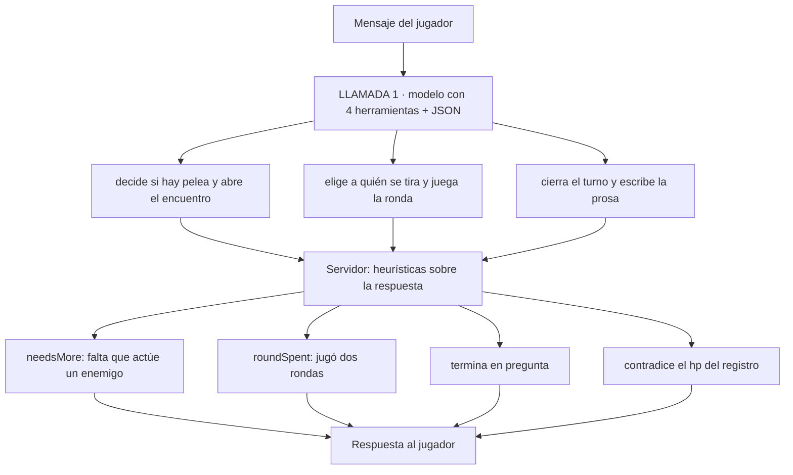
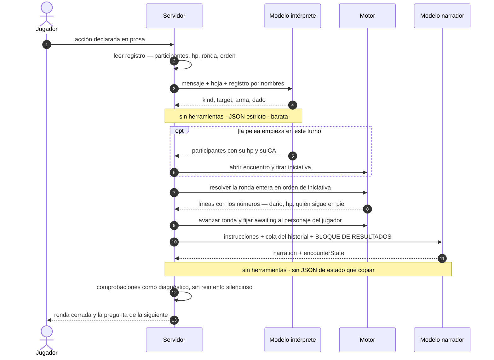
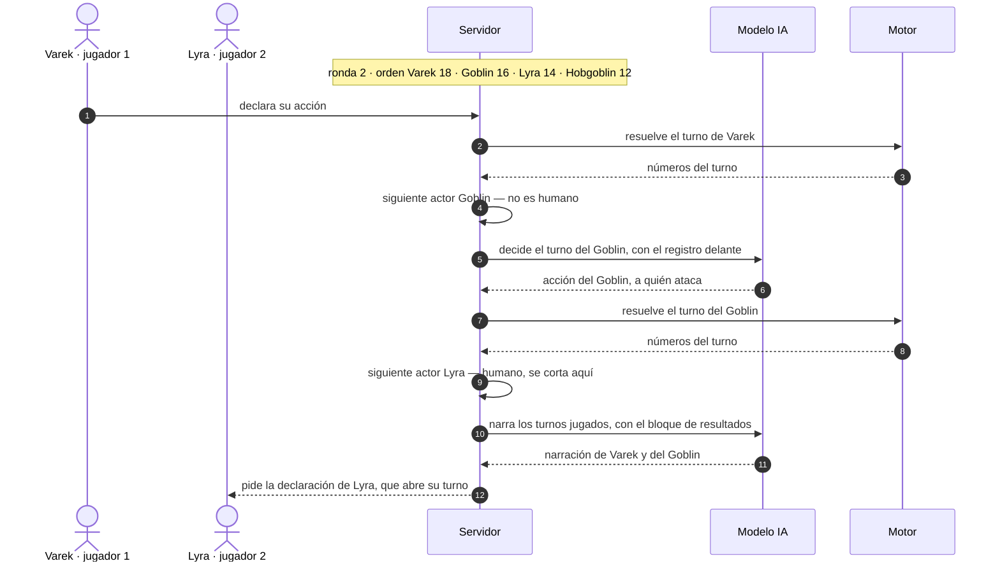
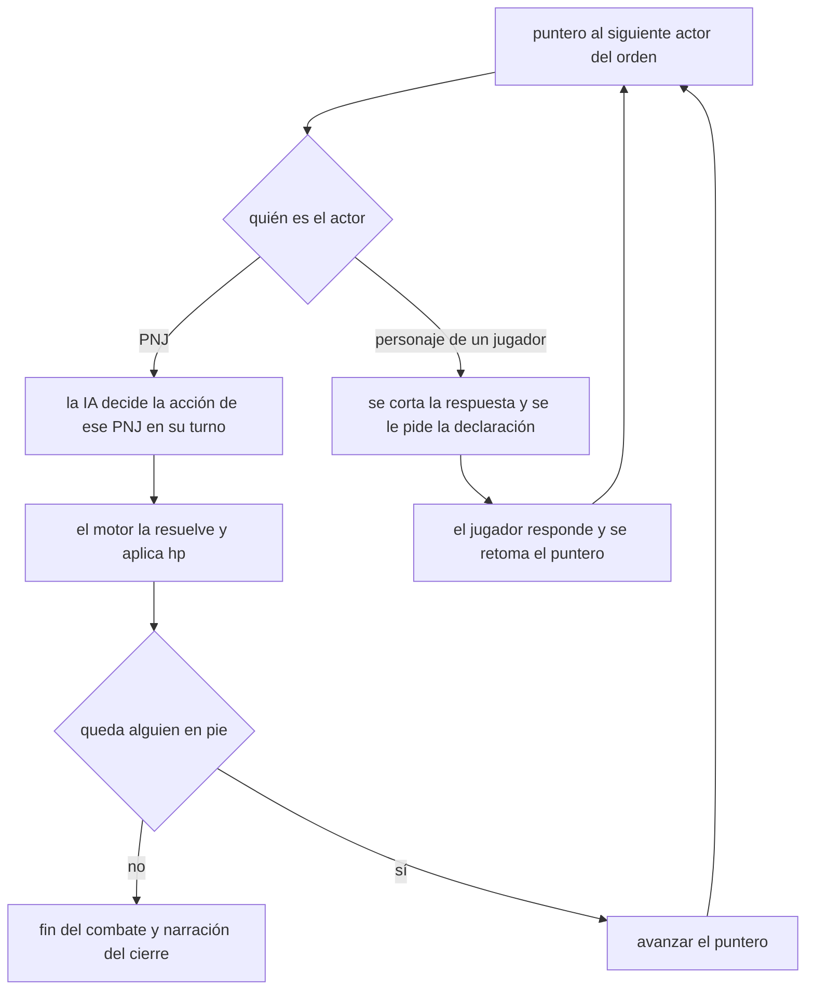
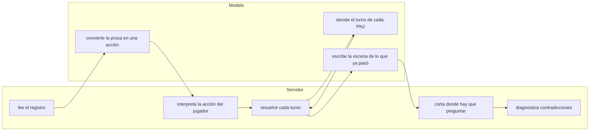

# Partir el turno de combate en dos llamadas

## Hoy: una llamada con herramientas

El modelo decide la estructura entera del turno —abre el encuentro, elige a quién se tira, juega la
ronda y la cierra— y el servidor tapa los huecos con heurísticas sobre el texto.

## Propuesta: el motor decide la estructura, el modelo escribe

## Con varios jugadores: la respuesta se corta donde un humano tiene que hablar

El puntero del motor recorre el orden de iniciativa. Si el actor es el personaje de un jugador, la
respuesta se detiene y se le pide la declaración **a ese jugador**. Si el actor es un PNJ, la IA decide
la acción de ese PNJ **en su propio turno**, con el registro delante, y el motor la resuelve antes de
pasar al siguiente. Una misma respuesta puede contener varios turnos de PNJ seguidos; lo que nunca
contiene es el turno de un jugador, porque ese lo abre su mensaje.

El bucle del puntero, en una vista:

## El reparto, en una vista

## Qué desaparece

- El bucle de herramientas en combate: `open_encounter`, `roll`, `request_action`, `encounter`.
- Las heurísticas que tapaban al modelo: `roundSpent`, el cierre por texto, la pregunta añadida,
  el reintento por ronda incompleta. El motor ya sabe cuándo acaba una ronda y a quién le toca.
- El riesgo de que el modelo juegue dos rondas o se salte un turno: no tiene con qué.

## Qué queda

- `combatTools` deja de ser una API para el modelo y pasa a ser la API interna del motor: misma
  lógica de dados, hp, hojas e iniciativa, sin reescribir nada de eso.
- El registro sigue siendo la única verdad, y lleva quién espera (`awaiting`) y qué ronda corre.
- `encounterState` en la respuesta del narrador queda como contraste; su ausencia se diagnostica con
  su causa, sin reintento automático.

## Coste

- Una llamada más por turno de combate, más una por cada turno de PNJ que quepa en la respuesta. A
  cambio, la narración es una llamada simple: sin herramientas, con `json_object` disponible otra vez
  y con un bloque de resultados delante en lugar de un registro que copiar.
- El intérprete tiene que acertar la acción declarada; es una tarea mucho más pequeña que la actual
  (una frase a un objeto) y ya está probada en el camino que se usa cuando el host rechaza herramientas.

## Decisiones abiertas

- **Turno de PNJ: una llamada por turno o una por bloque.** Por turno es lo más fiel —cada criatura
  decide viendo lo que acaba de pasar, y puede reaccionar a la caída de un aliado— y cuesta una llamada
  por PNJ. Por bloque decide de golpe todos los PNJ que actúan antes del siguiente jugador: menos
  latencia, menos reacción en cadena.
- **Quién controla los otros personajes.** Con varios jugadores humanos, cada uno declara el suyo. Si
  un personaje del grupo no tiene jugador en la mesa, hay que decidir si lo lleva la IA en su turno
  como un PNJ, o si su turno espera siempre a un humano.
- **Quién propone las estadísticas de los enemigos nuevos** —hp y CA— cuando empieza la pelea: la
  llamada del intérprete, o una tabla del sistema con valores por tipo de criatura que el intérprete
  solo nombre.
