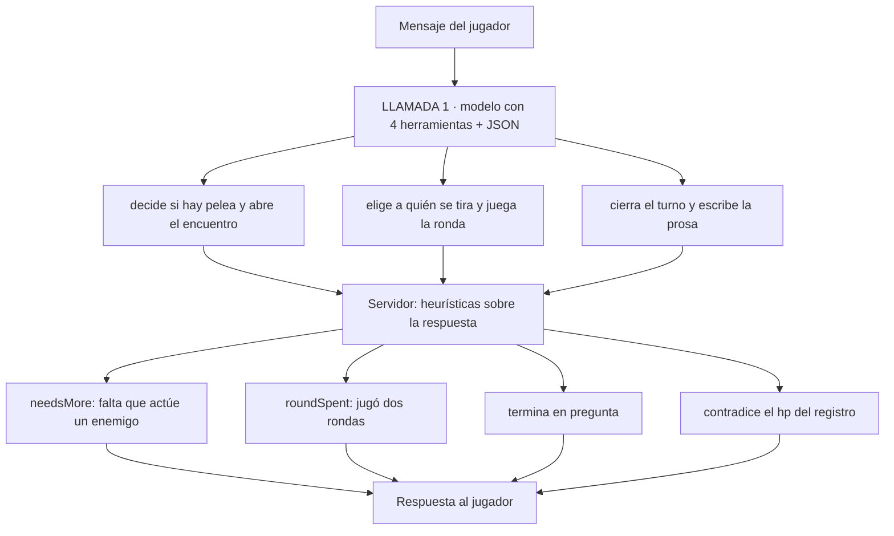
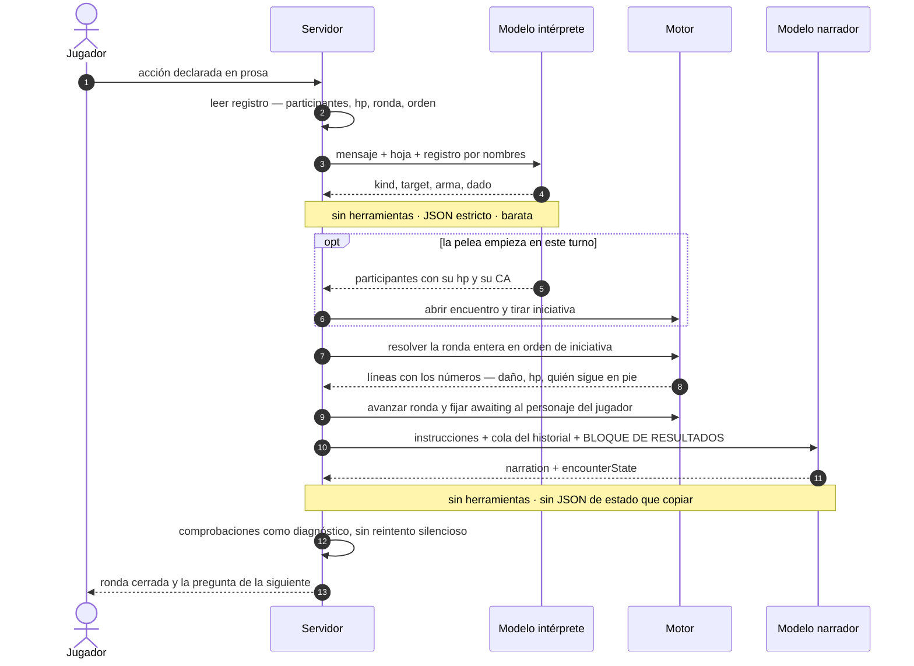
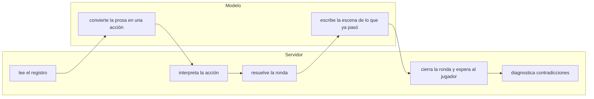

# Partir el turno de combate en dos llamadas

## Hoy: una llamada con herramientas

El modelo decide la estructura entera del turno —abre el encuentro, elige a quién se tira, juega la
ronda y la cierra— y el servidor tapa los huecos con heurísticas sobre el texto.

## Propuesta: el motor decide la estructura, el modelo escribe

## El reparto, en una vista

## Qué desaparece

- El bucle de herramientas en combate: `open_encounter`, `roll`, `request_action`, `encounter`.
- Las heurísticas que tapaban al modelo: `roundSpent`, el cierre por texto, la pregunta añadida,
  el reintento por ronda incompleta. El motor ya sabe cuándo acaba una ronda: no hay nada que deducir.
- El riesgo de que el modelo juegue dos rondas: no tiene con qué.

## Qué queda

- `combatTools` deja de ser una API para el modelo y pasa a ser la API interna del motor: misma
  lógica de dados, hp, hojas e iniciativa, sin reescribir nada de eso.
- El registro sigue siendo la única verdad. `encounterState` en la respuesta del narrador queda como
  contraste, y su ausencia se diagnostica con su causa, como ahora.

## Coste

- Una llamada más por turno de combate, la del intérprete, a cambio de que la narración sea una
  llamada simple: sin herramientas, con `json_object` disponible otra vez y con un bloque de
  resultados delante en lugar de un registro que copiar.
- El intérprete tiene que acertar la acción declarada; es una tarea mucho más pequeña que la actual
  (una frase a un objeto) y ya está probada en el camino que se usa cuando el host rechaza herramientas.

## Decisión abierta

Quién propone las estadísticas de los enemigos nuevos —hp y CA— cuando la pelea empieza: la llamada
del intérprete, o una tabla del sistema con valores por tipo de criatura que el intérprete solo nombre.
